# Отчёт по лабораторной работе №2. Node-RED

**Студент:** Дусов Алексей
**Группа:** СПД ИИ-241

## 1. Среда развертывания и версии

* **Способ установки:** Docker Desktop, официальный образ `nodered/node-red:latest`, запуск через `docker compose up -d` из папки `lab2` (файл [docker-compose.yml](../docker-compose.yml)).
* **Volume:** локальная папка `lab2/node-red-data` на хосте → `/data` в контейнере. Папка добавлена в `.gitignore`: в ней лежит `flows_cred.json` с токеном бота.
* **Порт:** `1880:1880`.
* **Версии ПО (из логов контейнера `docker logs node-red-dusov`):**
  * **Node-RED:** `v5.0.7`
  * **Node.js:** `v24.20.0`
* **Дополнительные пакеты:** `node-red-dashboard` 3.6.6, `node-red-contrib-telegrambot` 19.0.3.
* **Доступ к интерфейсу:** редактор — `http://localhost:1880`, dashboard — `http://localhost:1880/ui`.

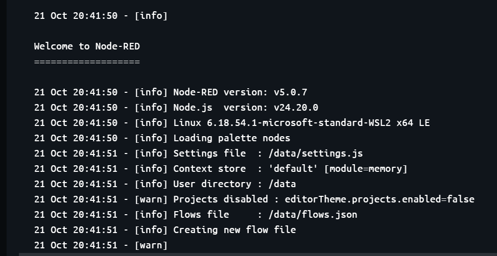

---

## 2. Краткое описание выполненной работы

Собрано 12 потоков, каждый сохранён отдельным файлом в `lab2/flows/` (а `all-flows.json` импортирует сразу все вкладки). Предметная область — строительные материалы. Фамилия и группа используются в `msg.topic`, payload и названиях вкладок.

1. **Базовые потоки и преобразования:**
   * `inject` → `debug`: каждые 5 с отправляется строка с фамилией и группой, `msg.topic = lab2/dusov/basic`, debug показывает complete msg object.
   * `function`: статистика показаний датчика температуры (среднее, минимум, максимум, значения выше порога, статус). В коде есть let/const, if/else, цикл for, массив и объект.
   * `switch`: ветвление по `msg.payload.status` — `high` уходит на выход 1, остальное на выход 2.
   * `change`: задаёт `msg.topic`, `msg.timestamp` (текущее время) и `msg.payload`.
   * `template`: Mustache-шаблон собирает JSON из объекта с тремя полями (студент, группа, материал).
2. **Сетевые протоколы и API:**
   * `http request`: GET к публичному API `https://catfact.ninja/fact`, ответ разбирается как JSON.
   * `mqtt out` / `mqtt in`: публикация случайной температуры раз в 5 с в топик `student/dusov/lab2/temperature` на публичном брокере HiveMQ и приём её обратно.
   * Собственное API на `http in` / `http response`: `/api/text`, `/api/info`, `/api/items` с query-параметрами `category` и `limit` и `/api/items/:id`, с кодами `200`, `400`, `404`. Описание — в [api.md](api.md).
3. **Пользовательский интерфейс и сервисы:**
   * Dashboard (`node-red-dashboard`): вкладка «Лаба 2 — Дусов», группа «Датчик температуры на складе», `gauge` с текущим значением и `chart` с историей за 10 минут. Inject раз в 2 с имитирует датчик.
   * Telegram-бот `tvl_lab2_dusov_bot` (`node-red-contrib-telegrambot`): команды `/start` и `/material` (случайный строительный материал), эхо-ответ на любой другой текст.
4. **Хранилище данных и контекст:**
   * Запись и чтение файла: каждая запись — строка JSON в `/data/lab2_dusov_deliveries.jsonl`. Файл лежит в volume, поэтому сохраняется после `docker restart`.
   * `flow context`: счётчик нажатий и 5 последних отметок времени, есть кнопка сброса. Значения видно на вкладке Context Data → Flow.

---

## 3. Использование AI (ИИ-ассистента)

AI использовался для генерации кода function-нод, Mustache-шаблона и JSON-структуры потоков. Подключение потоков, запуск в Docker, установка пакетов и проверка каждого потока выполнялись вручную.

**Ключевые примеры промптов:**
* *«Напиши код function node для Node-RED: на входе msg.payload = { student, readings: [числа] }. Используй let/const, if/else, цикл for, массив и объект. Посчитай среднее, минимум, максимум, значения выше порога 25 и верни объект со статусом high / normal / empty»*
* *«Сделай Mustache-шаблон для ноды template, который из полей student, group, material собирает JSON с полем message»*
* *«Function node для GET /api/items: фильтр по query category, limit от 1 до 10, путь /api/items/:id; на неверный id верни 400, на несуществующий — 404, тело ответа — JSON с полем error»*
* *«Как в node-red-contrib-telegrambot ответить на /start и сделать echo на обычные сообщения, не повторяя команды?»*

---

## 4. Освоенные узлы (Nodes)

* **Базовые:** `inject`, `debug`, `function`, `switch`, `change`, `template`, `comment`.
* **Сетевые и Web:** `http request`, `http in`, `http response`, `mqtt in`, `mqtt out`, `mqtt-broker` (config).
* **Интерфейс и интеграции:** `ui_gauge`, `ui_chart`, `ui_group`, `ui_tab`, `telegram bot` (config), `telegram command`, `telegram receiver`, `telegram sender`.
* **Хранилище и контекст:** `file`, `file in`, контекстное хранилище `flow.get()` / `flow.set()`.

---

## 5. Скриншоты выполненных потоков

| Задание | Скриншот потока |
| :--- | :--- |
| **2.1. Inject → Debug** | 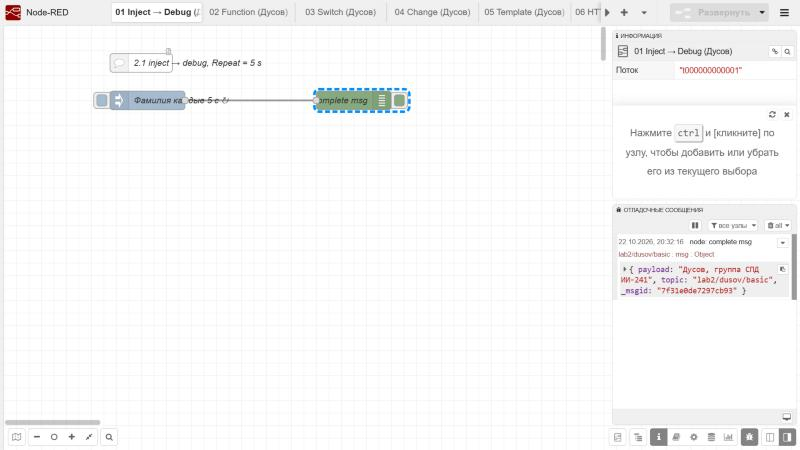 |
| **2.2. Function node** | 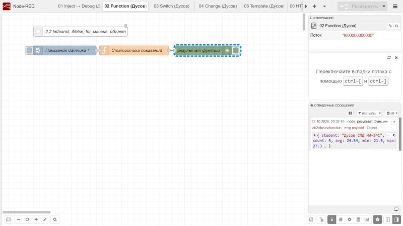 |
| **2.3. Switch node** | 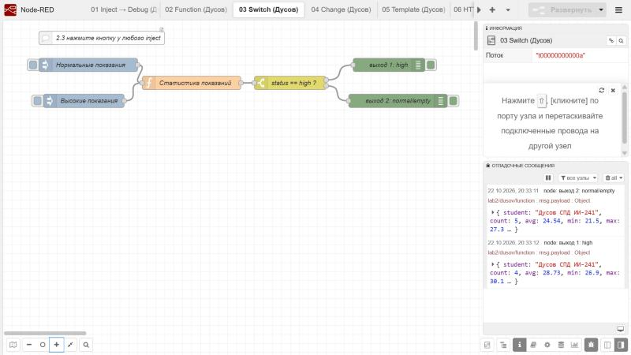 |
| **2.4. Change / Set node** | 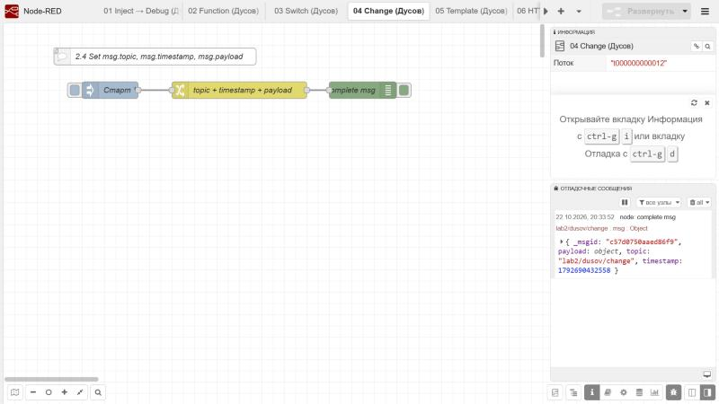 |
| **2.5. Template node** | 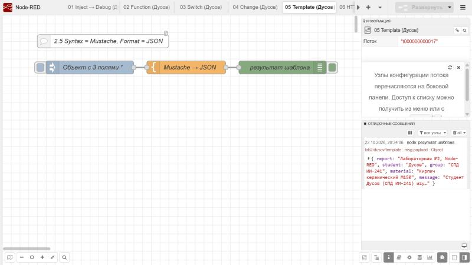 |
| **2.6. HTTP Request** | 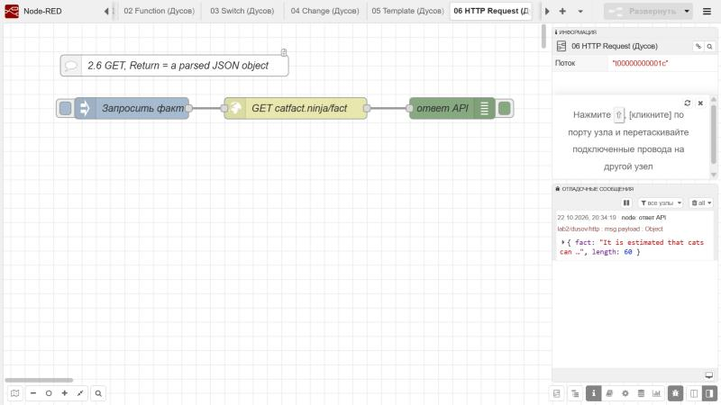 |
| **2.7. MQTT брокер** | 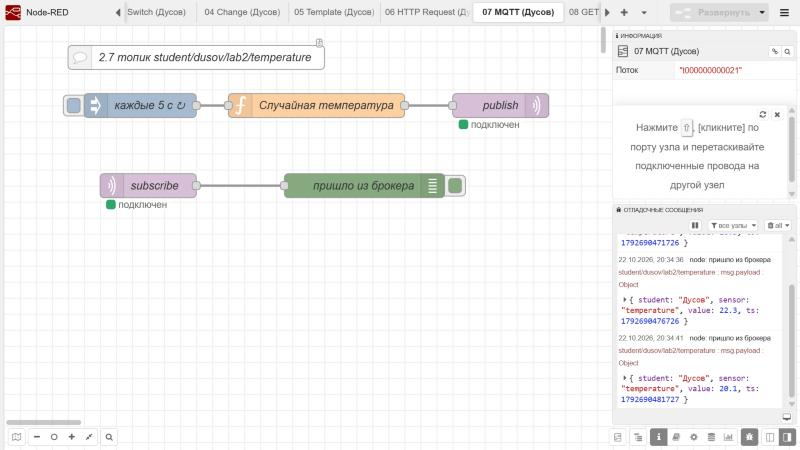 |
| **2.8. GET-эндпоинты (схема)** | 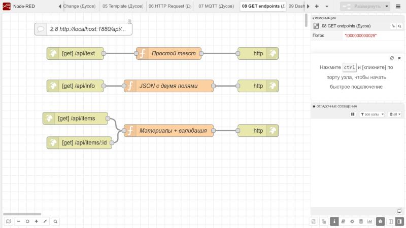 |
| **2.8. GET /api/text** | 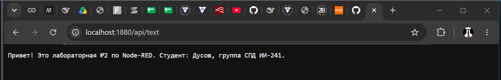 |
| **2.8. GET /api/info** | 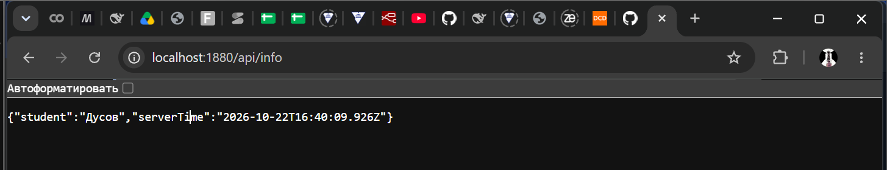 |
| **2.8. GET /api/items/2 (200 OK)** | 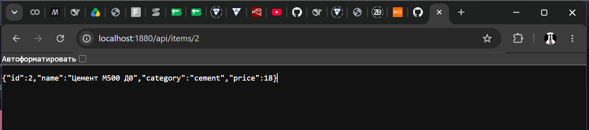 |
| **2.8. Ошибки (400 / 404)** | 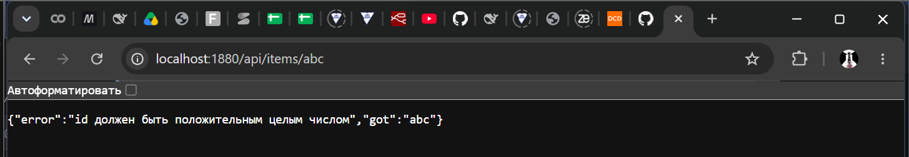 |
| **2.9. Dashboard (Gauge + Chart)** | 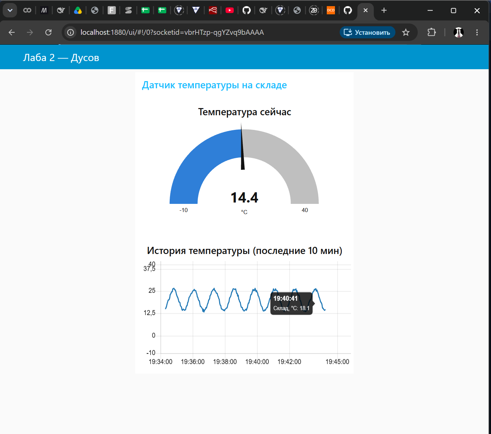 |
| **2.10. Telegram-бот** | 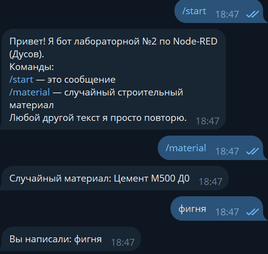 |
| **2.11. Чтение/запись файла** | 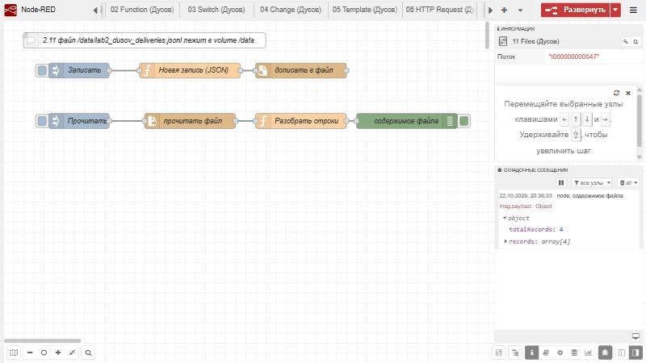 |
| **2.12. Flow context** | 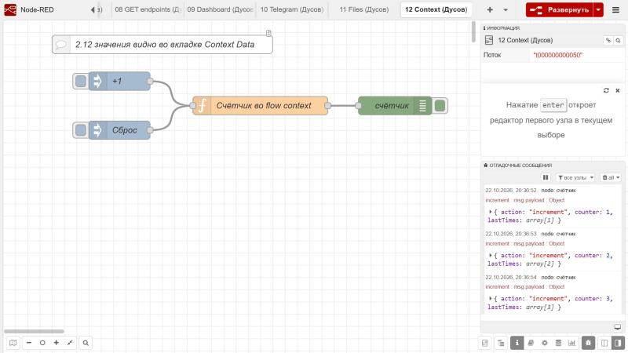 |

---

## 6. Вывод

[В ходе лабораторной работы разобрался, как в Node-RED собирать логику из готовых нод вместо написания всего кода вручную. Удобнее всего оказалось делать HTTP-эндпоинты, MQTT и dashboard: несколько нод — и всё работает. Сложнее было с Telegram-ботом и с тем, где Node-RED в Docker хранит данные: без volume файлы и установленные ноды пропадали бы при перезапуске контейнера.]
