# Отчёт по лабораторной работе №4. n8n

**Студент:** Дусов Алексей
**Группа:** СПД ИИ-241

## 1. Установка и запуск n8n

* **Способ установки:** Docker Desktop, официальный образ `n8nio/n8n:latest`, запуск через `docker compose up -d` из папки `lab4` (файл [docker-compose.yml](../docker-compose.yml)).
* **Версия n8n:** `2.44.6`.
* **Порт:** `5678:5678`, редактор — `http://localhost:5678`.
* **Volume 1:** `./n8n-data` (хост) → `/home/node/.n8n` (контейнер) — база n8n, workflow, credentials и ключ шифрования.
* **Volume 2:** `./files` (хост) → `/data` (контейнер) — папка для файлов.
* **Прочие параметры запуска:**

| Переменная / параметр | Значение | Зачем |
| --- | --- | --- |
| `TZ`, `GENERIC_TIMEZONE` | `Europe/Minsk` | правильное время в Schedule Trigger и в `$now` |
| `N8N_HOST`, `N8N_PORT`, `N8N_PROTOCOL` | `localhost`, `5678`, `http` | адрес, на котором работает редактор |
| `N8N_SECURE_COOKIE` | `false` | вход по `http://localhost` без HTTPS |
| `N8N_RUNNERS_ENABLED` | `true` | Code-ноды выполняются в отдельном task runner |
| `N8N_ENFORCE_SETTINGS_FILE_PERMISSIONS` | `true` | строгие права на файл настроек |
| `extra_hosts` | `host.docker.internal:host-gateway` | доступ из контейнера n8n к Redis на хосте |
| `restart` | `unless-stopped` | автозапуск вместе с Docker |

* После запуска открыт `http://localhost:5678` и зарегистрирован владелец (owner) n8n.
* Папки `n8n-data/` и `files/` добавлены в `.gitignore`: в них база и ключ шифрования credentials.

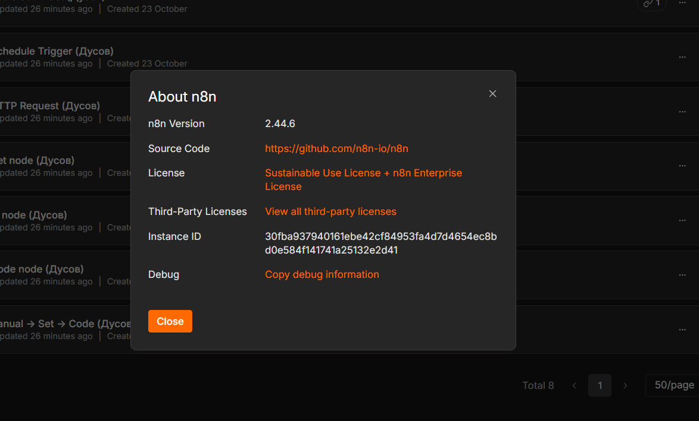

---

## 2. Краткое описание выполненного

Собрано 8 workflow, каждый экспортирован отдельным файлом в `lab4/flows/`. В именах workflow, payload и topic используются фамилия и группа.

| № | Файл | Ноды | Что делает |
| --- | --- | --- | --- |
| 2.1 | `flow-01-manual-set.json` | Manual Trigger → Set → Code | Set задаёт `payload = "Дусов, группа СПД ИИ-241"` и `topic = "lab4/dusov/basic"`, Code выводит данные в консоль и возвращает их |
| 2.2 | `flow-02-code.json` | Manual Trigger → Code → NoOp | статистика показаний двух складов: let/const, if/else, for, массив, объект; результат — объект с полем `payload` |
| 2.3 | `flow-03-if.json` | Manual Trigger → Code → IF → NoOp (true) / NoOp (false) | IF по `payload.status = high`: склад №2 (среднее 28.73) → true, склад №1 (24.54) → false |
| 2.4 | `flow-04-set.json` | Manual Trigger → Set → Code | Set задаёт `topic`, `timestamp = {{ $now.toISO() }}` и `payload` (объект); Code показывает полный объект сообщения, его поля и типы |
| 2.5 | `flow-05-http.json` | Manual Trigger → HTTP Request → Code | GET `https://catfact.ninja/fact`, Response Format = JSON; Code разбирает ответ |
| 2.6 | `flow-06-schedule.json` | Schedule Trigger → Code | запуск каждые 5 минут, Code возвращает текущее время (ISO и местное) |
| 3 | `flow-09-redis.json` | Manual Trigger → Redis Set → Redis Get | создание ключа `dusov` и чтение его значения |
| 3 | `flow-10-redis.json` | Manual Trigger → Redis Delete → Redis Keys → Code | удаление ключа и проверка, что его больше нет |

Подробно про Redis — в [redis.md](redis.md).

Все workflow проверены запуском: в редакторе и командой `n8n execute --id=<id>` внутри контейнера. Статус всех нод — `success`.

---

## 3. Использование AI

AI использовался для генерации кода Code-нод, JSON-структуры workflow и docker-compose. Запуск контейнеров, импорт, credentials Redis и проверка каждого workflow выполнены и проверены вручную. При проверке найдена ошибка в сгенерированном коде проверки ключа (она всегда возвращала `exists: false`) — исправлена и протестирована в обоих случаях.

**Ключевые примеры промптов:**
* *«Составь docker-compose для n8n: образ n8nio/n8n, порт 5678, volume для /home/node/.n8n и второй volume для /data, часовой пояс Europe/Minsk, плюс Redis 7 на порту 6379»*
* *«Напиши код Code-ноды n8n, который использует let/const, if/else, цикл for, массив и объект: считает среднее, минимум и максимум показаний датчика и возвращает объект с полем payload и статусом high/normal»*
* *«В Redis-ноде n8n нет операции Exists. Как проверить, что ключ удалён? Напиши Code-ноду, которая по результату операции Keys возвращает exists: true/false»*

---

## 4. Освоенные ноды

* **Триггеры:** `Manual Trigger`, `Schedule Trigger`.
* **Данные и логика:** `Set (Edit Fields)`, `Code` (JavaScript), `IF`, `No Operation (NoOp)`.
* **Сеть:** `HTTP Request`.
* **Хранилище:** `Redis` (операции Set, Get, Delete, Keys), credentials Redis.
* **Выражения:** `{{ $json... }}`, `{{ $now.toISO() }}`, `$input.all()` / `$input.first()` в Code.

---

## 5. Скриншоты

| Задание | Скриншот |
| :--- | :--- |
| **1. Версия n8n** |  |
| **2.1. Manual Trigger → Set → Code (схема)** | 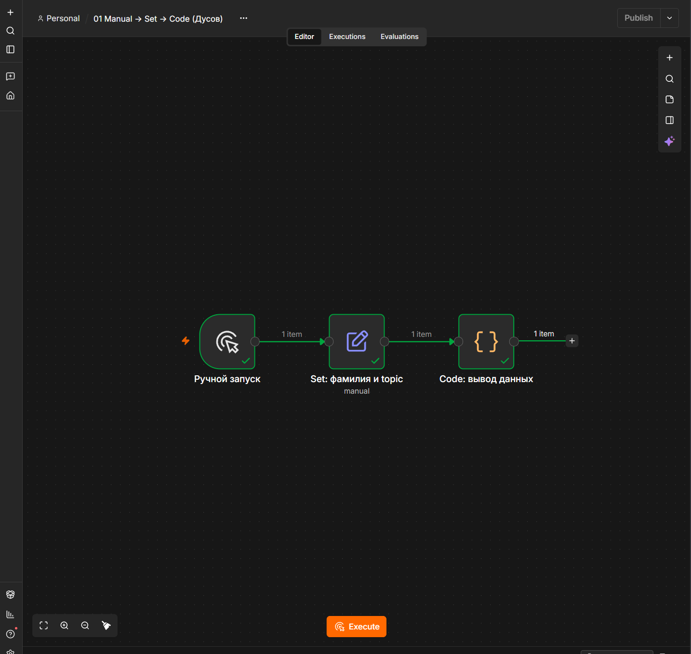 |
| **2.1. Manual Trigger → Set → Code (результат)** | 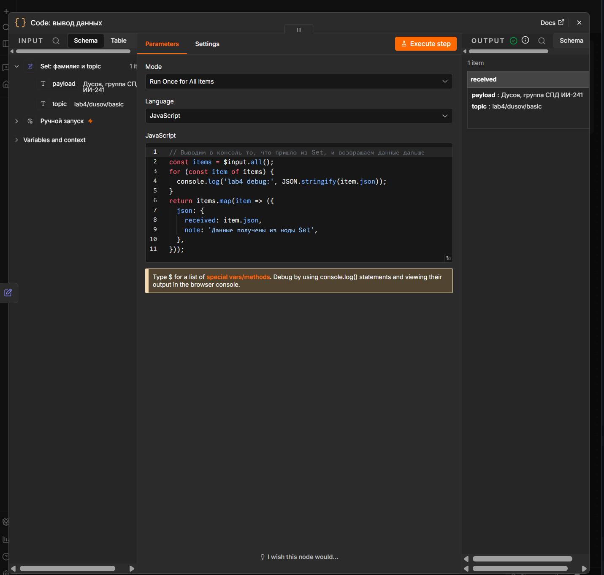 |
| **2.2. Code node** | 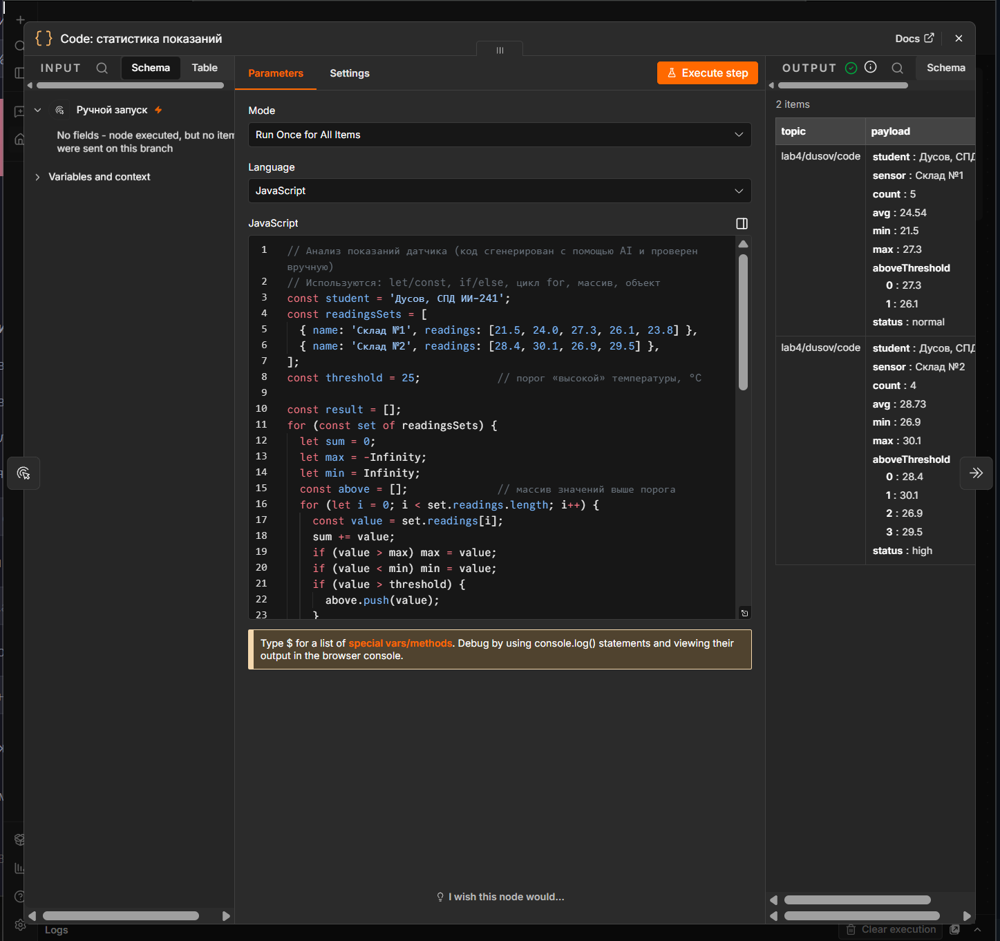 |
| **2.3. IF node** | 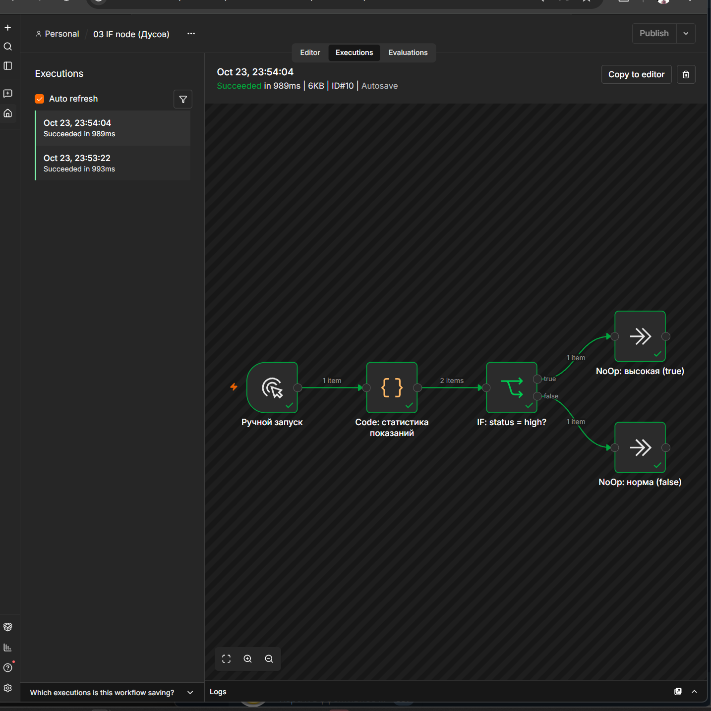 |
| **2.4. Set node** | 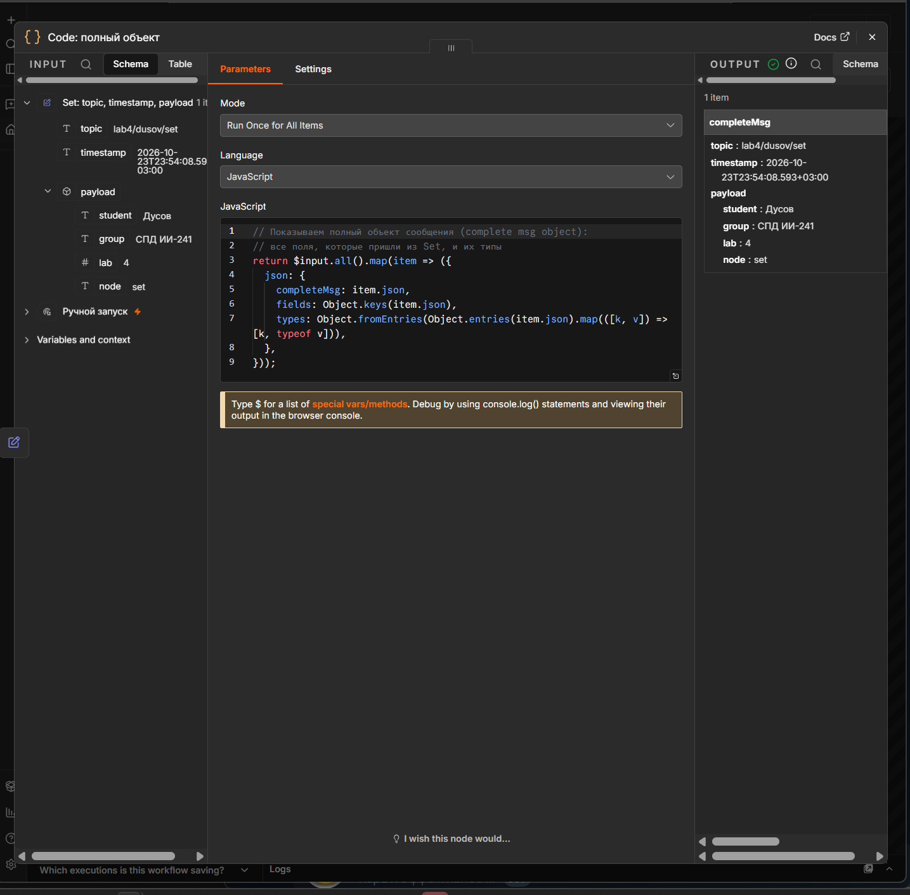 |
| **2.5. HTTP Request** | 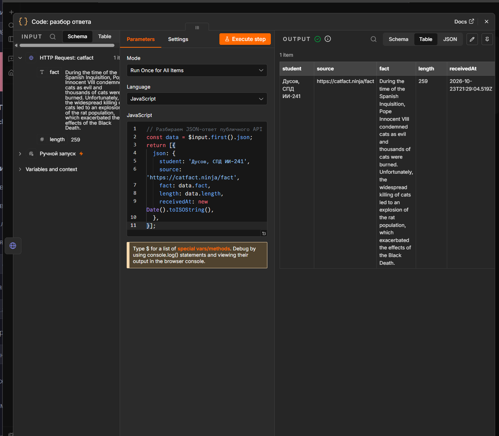 |
| **2.6. Schedule Trigger** | 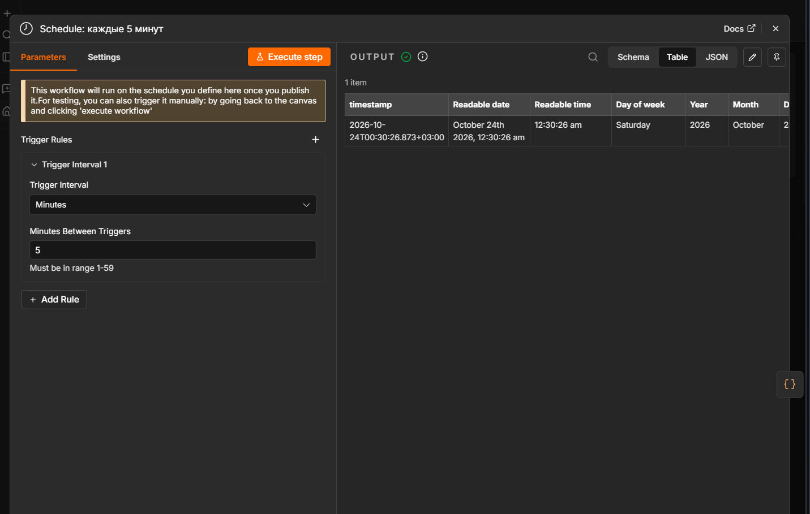 |
| **3. Redis: создание ключа (Set)** | 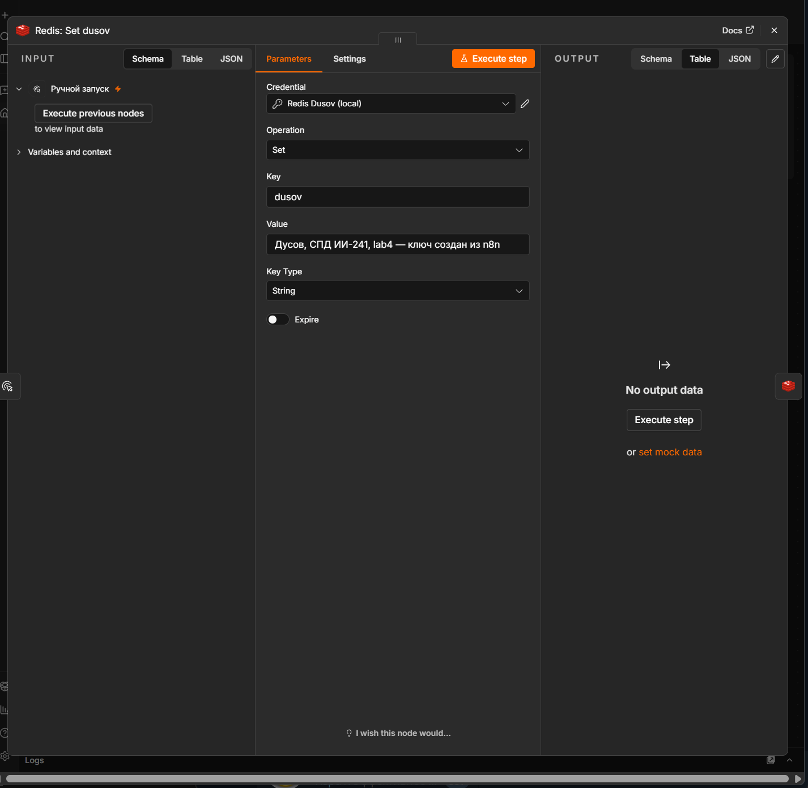 |
| **3. Redis: чтение значения (Get)** | 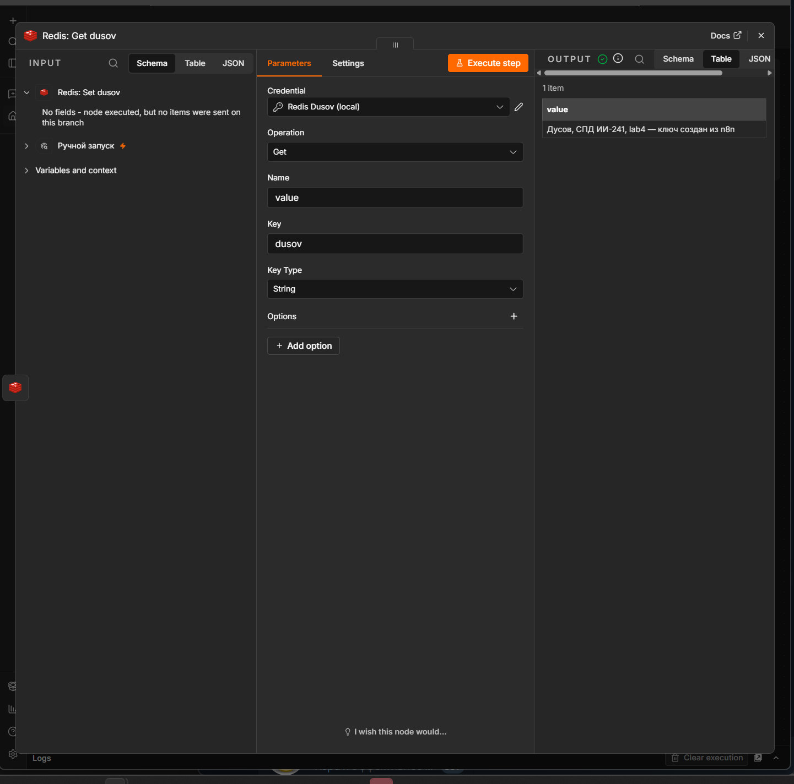 |
| **3. Redis: удаление (Delete)** | 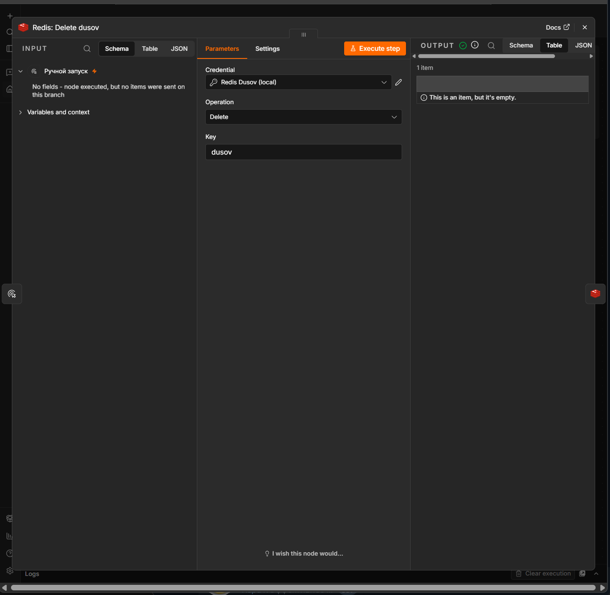 |
| **3. Redis: проверка отсутствия** | 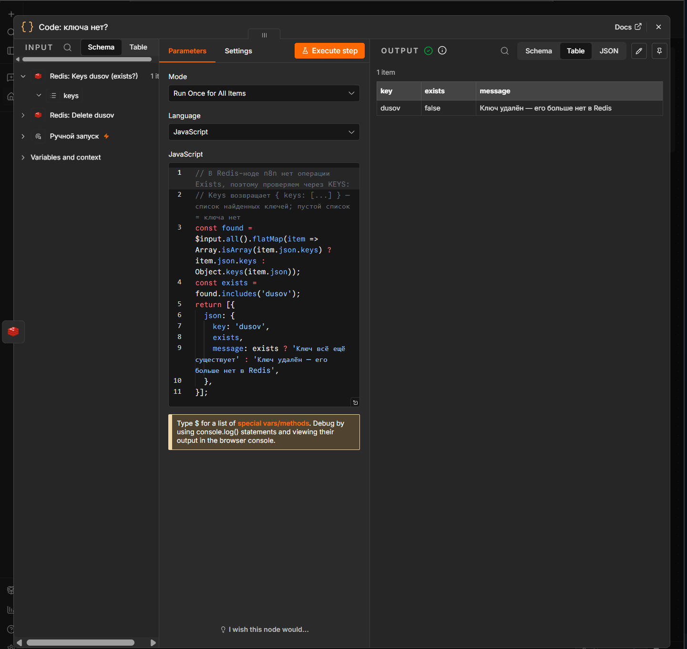 |

---

## 6. Вывод

[ она похоже на то что мы делали ,  только  с настройками доступа
 а так я уже не знаю что сказать ]
