# Отчёт по лабораторной работе №5. Чат-боты

**Студент:** Дусов Алексей
**Группа:** СПД ИИ-241
**Трек:** C. TypeBot (self-hosted)

## 1. Краткое описание

Выбран трек **TypeBot**. TypeBot поднят у себя (self-hosted) в Docker. В workspace `lab5-Дусов-СПД-ИИ-241` из каталога Templates взят шаблон **Lead Generation** — бот агентства, который собирает заявки. Шаблон полностью русифицирован и доработан: добавлены 4 новые группы с HTTP-запросом, числовым вводом, условием Condition, блоками Set variable и 4 новыми переменными, сменены тема и брендинг. Бот опубликован web-ссылкой и проверен двумя полными диалогами.

## 2. Установка (self-hosted)

Файл [docker-compose.yml](../docker-compose.yml), запуск — `docker compose up -d` из папки `lab5`.

| Сервис | Образ | Адрес | Зачем |
| --- | --- | --- | --- |
| `typebot-builder` | `baptistearno/typebot-builder` | `http://localhost:8080` | редактор ботов |
| `typebot-viewer` | `baptistearno/typebot-viewer` | `http://127.0.0.1:8081` | опубликованные боты |
| `typebot-db` | `postgres:16` | — | база данных TypeBot (volume `./typebot-db`) |
| `mailpit` | `axllent/mailpit` | `http://localhost:8025` | локальная почта: в TypeBot нет пароля, вход по ссылке или коду из письма |

Особенности настройки:
* `ENCRYPTION_SECRET` (32 символа) хранится в файле `.env`, он вместе с базой добавлен в `.gitignore`.
* Адрес viewer должен отличаться от адреса builder **именем хоста**, а не только портом: cookie браузера не учитывают порт. Поэтому builder открыт на `localhost:8080`, а viewer — на `127.0.0.1:8081`. Без этого не работал предпросмотр шаблонов.
* Вход: email `dusov@lab5.local` → письмо с кодом приходит в Mailpit (`http://localhost:8025`).

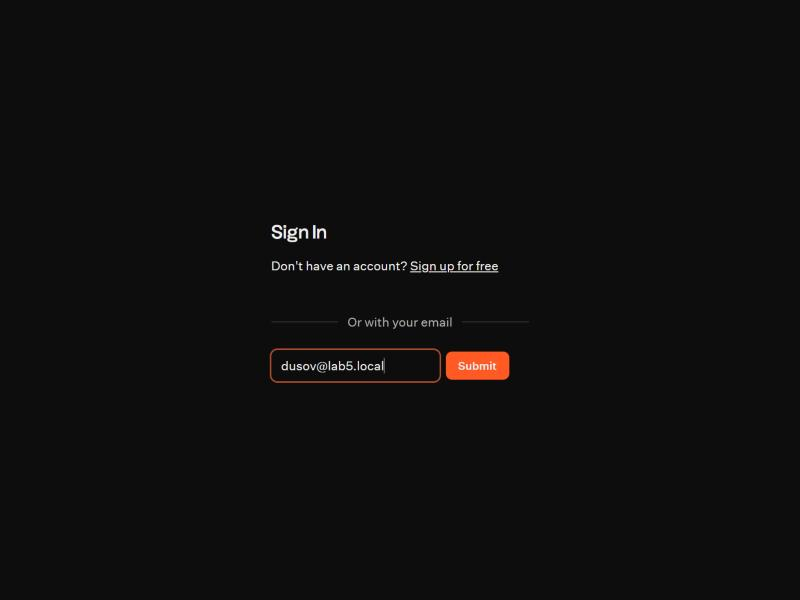
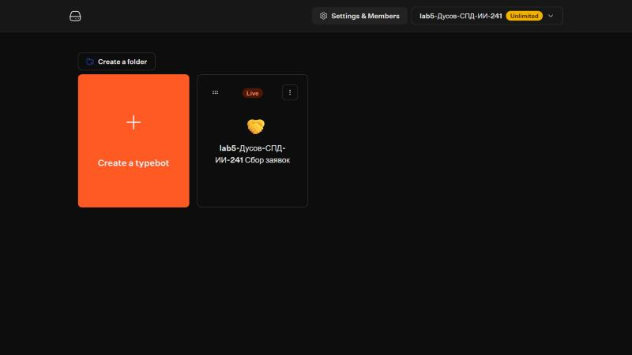

## 3. Ссылка на бота

Опубликованный бот: **http://127.0.0.1:8081/lab5-241-ev8igr6**

Ссылка локальная: она работает на компьютере, где запущен Docker с TypeBot.

## 4. Шаблон «до» и русификация

Исходный шаблон — **Lead Generation**, его экспорт: [exports/flow-01-template-original.json](../exports/flow-01-template-original.json).

| Где | Было | Стало |
| --- | --- | --- |
| Название бота | Lead Generation | lab5-Дусов-СПД-ИИ-241 Сбор заявок |
| Приветствие | Welcome to **AA** (Awesome Agency) | Добро пожаловать в **АА** (Агентство Дусова) 👋 |
| Кнопка | Hi! | Привет! |
| Вопрос | What's your name? | Как вас зовут? |
| Плейсхолдер | Type your answer... | Введите ваше имя... |
| Кнопка ввода | Send | Отправить |
| Вопрос | What's the best email we can reach you at? | На какой email нам лучше написать? |
| Ошибка email | (английская по умолчанию) | Похоже, в email есть ошибка. Попробуйте ввести его ещё раз. |
| Кнопки услуг | Website dev / Content Marketing / Social Media / UI / UX Design | Разработка сайта / Контент-маркетинг / Социальные сети / UI / UX-дизайн |
| Вопрос | Can you tell me a bit more about your needs? | Расскажите немного подробнее о вашей задаче. |
| Прощание | Perfect! / We'll get back to you at {{Email}} | Отлично, заявка принята! ✅ / Мы свяжемся с вами по адресу {{Email}}. Ваш сегмент: {{Сегмент}}. |
| Названия групп | Welcome, Name, Email, Services, Additional information, Bye | Приветствие, Имя, Email, Услуги, Подробности, Прощание |
| Описание (SEO) | — | «Чат-бот для сбора заявок: имя, email, услуга и бюджет. ТВП: Дусов, СПД ИИ-241.» |

После перевода переменные `{{Name}}` и `{{Email}}` подставляются правильно, логика не сломалась — это проверено диалогами (раздел 7).

| До | После |
| :---: | :---: |
| 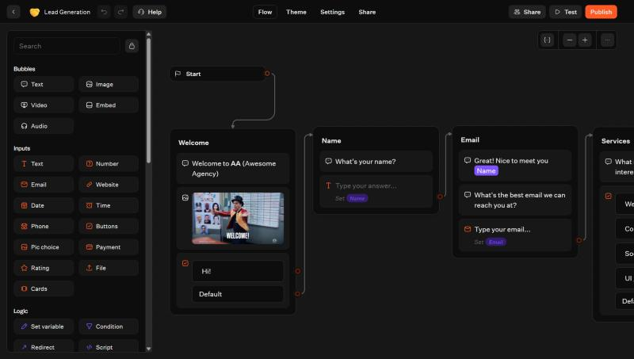 | 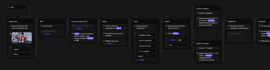 |

## 5. Изменения в логике

Новый сценарий:

```text
Приветствие → Имя → Возраст по имени (HTTP) → Email → Услуги → Бюджет
   → [Condition: Бюджет > 1000] → Сегмент: Премиум ─┐
   → [иначе]                    → Сегмент: Стандарт ─┴→ Подробности → Прощание
```

| Требование | Что сделано |
| --- | --- |
| **Минимум 2 новых блока/шага** | 4 новые группы: «Возраст по имени (HTTP)», «Бюджет», «Сегмент: Премиум», «Сегмент: Стандарт» — в них блоки HTTP request, Text, Number input, Condition, Set variable; в «Прощание» добавлена строка «ТВП: Дусов, СПД ИИ-241» |
| **Condition** | в группе «Бюджет»: если `Бюджет` **Greater than** `1000` → «Сегмент: Премиум», иначе → «Сегмент: Стандарт» |
| **Variable** | новые переменные `Возраст`, `Услуга`, `Бюджет`, `Сегмент`; `Сегмент` задаётся блоком **Set variable** («Премиум» / «Стандарт») и выводится в прощании |
| **HTTP Request** | блок HTTP request (Webhook): `GET https://api.agify.io/?name={{Name}}`, ответ `data.age` сохраняется в переменную `Возраст` |
| **Тема и брендинг** | шрифт Montserrat, светло-зелёный фон `#F1F8E9`, кнопки и ответы гостя `#2E7D32`, прогресс-бар; отключён брендинг «Made with Typebot» |

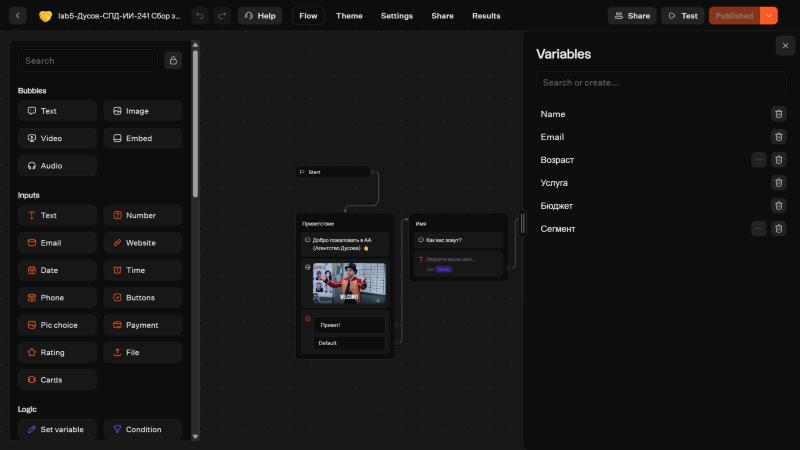
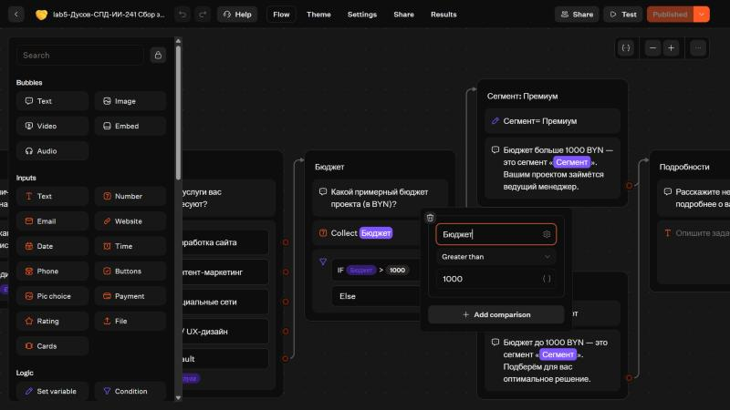
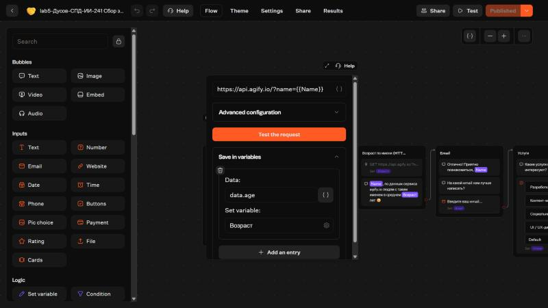
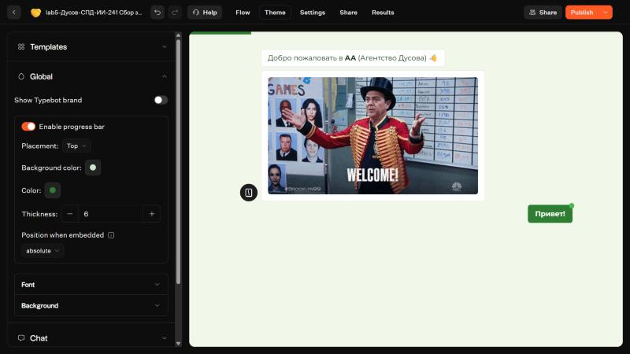

Итоговый экспорт: [exports/flow-02-lead-generation-ru.json](../exports/flow-02-lead-generation-ru.json).

## 6. Публикация

Бот опубликован **web-ссылкой**: `http://127.0.0.1:8081/lab5-241-ev8igr6`.

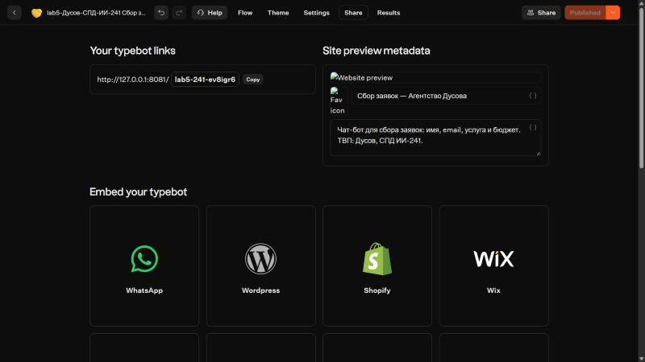

## 7. Результат

Бот пройден двумя сценариями через API viewer — `startChat` и `continueChat`:

| Шаг | Сценарий 1 | Сценарий 2 |
| --- | --- | --- |
| Имя | Алексей | Мария |
| HTTP (agify.io) | «…в среднем 35 лет» | «…в среднем 35 лет» |
| Email | сначала `не-email` → сообщение об ошибке, затем `dusov@example.com` | `maria@example.com` |
| Услуга | Разработка сайта | Социальные сети |
| Бюджет | 5000 → **Премиум** | 300 → **Стандарт** |
| Прощание | «…Ваш сегмент: Премиум.» | «…Ваш сегмент: Стандарт.» |

Третий диалог пройден вручную в браузере по опубликованной ссылке (Алексей, бюджет 5000 → «Премиум»), см. скриншот ниже.

Ответы сохраняются во вкладке **Results** TypeBot (фильтр «All time» — 3 заявки).

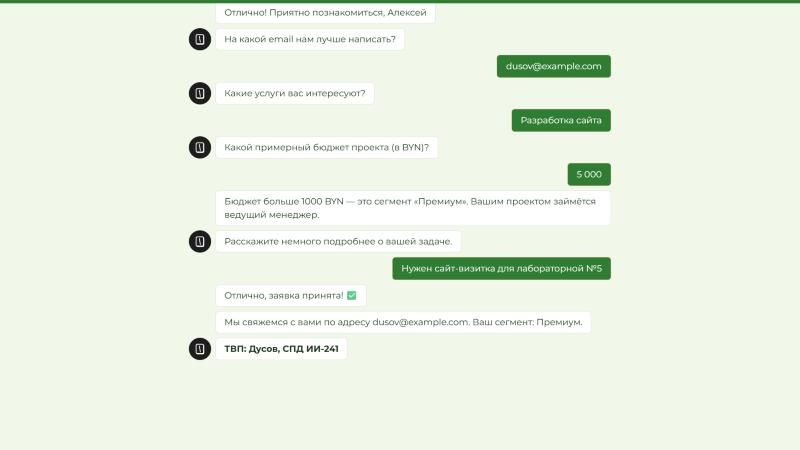
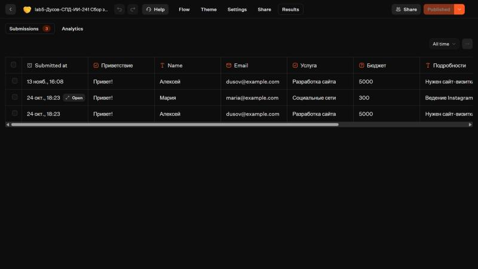

## 8. Использованные AI-промпты

* *«Как поднять TypeBot self-hosted в Docker: builder, viewer, PostgreSQL и вход по email без настоящего SMTP-сервера?»* — подсказал Mailpit как локальную почту.
* *«Переведи на русский все тексты, кнопки, плейсхолдеры и сообщения об ошибках шаблона Lead Generation в TypeBot, не трогая переменные в фигурных скобках»*
* *«Какой бесплатный публичный API без ключа можно вызвать из HTTP-блока TypeBot по имени пользователя?»* — выбран agify.io.
* *«Добавь в бот сбора заявок вопрос о бюджете и ветвление: если бюджет больше 1000 — сегмент Премиум, иначе Стандарт, с записью сегмента в переменную»*

## 9. Освоенные блоки

* **Bubbles:** Text, Image.
* **Inputs:** Buttons (choice input), Text, Email (с сообщением об ошибке), Number.
* **Logic:** Condition, Set variable.
* **Integrations:** HTTP request (Webhook) с маппингом ответа в переменную.
* **Прочее:** переменные `{{...}}`, группы и связи (edges), Theme, Settings (брендинг, метаданные), Publish, Share, Results, экспорт и импорт JSON.

## 10. Вывод

[Напишите своими словами 3–5 предложений: чем TypeBot удобен для чат-ботов, как работают переменные и условия, что было сложным (например, self-hosted установка и вход по почте), чем бот в TypeBot отличается от Telegram-бота в Node-RED.]
