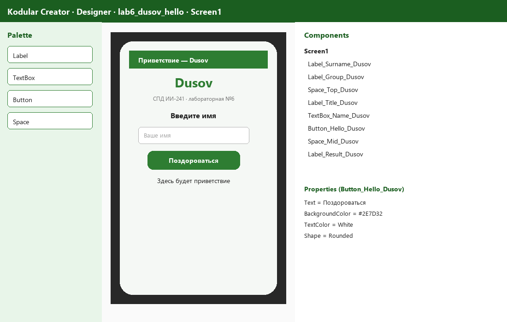
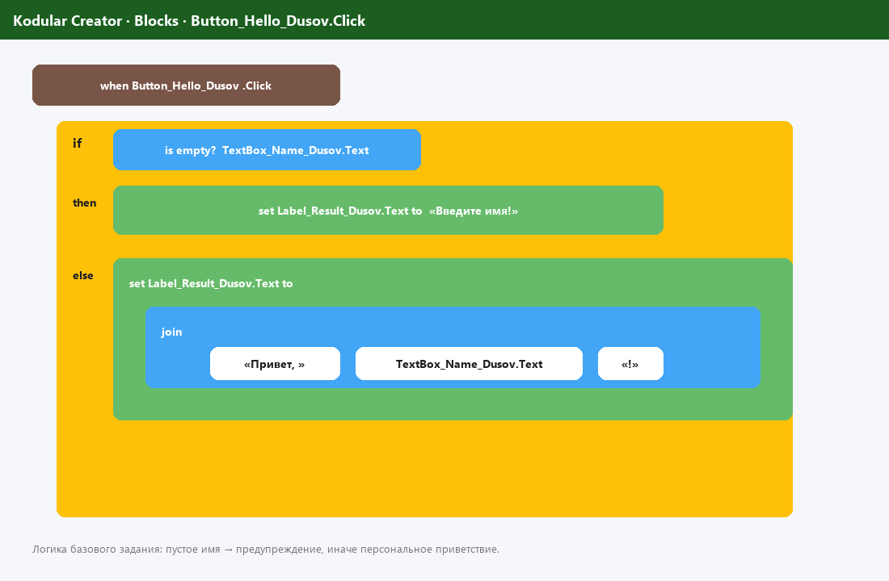
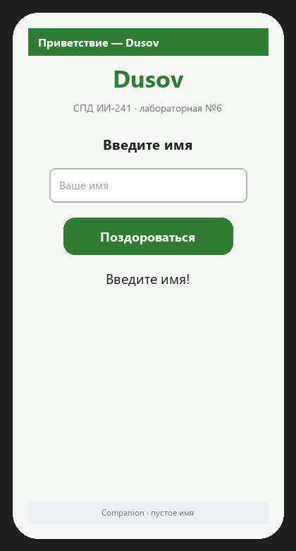
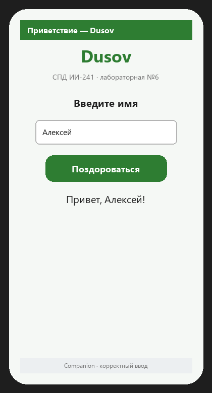

# Отчёт по лабораторной работе №6. Kodular

**Студент:** Дусов Алексей
**Группа:** СПД ИИ-241

## 1. Краткое описание

В Kodular (бесплатный тариф) создано мобильное приложение «Приветствие» — проект `lab6_dusov_hello`. На первом экране сверху крупно выведена фамилия на английском — **Dusov**. Пользователь вводит имя и нажимает «Поздороваться»: если поле пустое, приложение просит ввести имя, иначе выводит «Привет, <имя>!».

Ачивки не выполнялись — сдаётся базовое задание.

## 2. Проект

* Файл проекта: [exports/lab6-dusov.aia](../exports/lab6-dusov.aia) — импортируется в Kodular через **Projects → Import project (.aia) from my computer**.
* Публикация в Kodular Gallery не выполнялась — для сдачи достаточно файла `.aia` и скриншотов.

## 3. Дизайн экрана (Screen1)

| Компонент | Тип | Свойства |
| --- | --- | --- |
| `Label_Surname_Dusov` | Label | Text = **Dusov**, жирный, 22, зелёный — фамилия, видна при запуске |
| `Label_Group_Dusov` | Label | Text = «СПД ИИ-241 · лабораторная №6» |
| `Label_Title_Dusov` | Label | Text = «Введите имя» — заголовок |
| `TextBox_Name_Dusov` | TextBox | Hint = «Ваше имя», ширина 80 % |
| `Button_Hello_Dusov` | Button | Text = «Поздороваться», зелёный фон, белый текст, скруглённая |
| `Label_Result_Dusov` | Label | Text = «Здесь будет приветствие» — сюда выводится результат |
| `Space_Top_Dusov`, `Space_Mid_Dusov` | Space | отступы |

Screen1: Title = «Приветствие — Dusov», выравнивание по центру, основной цвет #2E7D32.

Состав экрана и свойств — по файлу `Screen1.scm` внутри [exports/lab6-dusov.aia](../exports/lab6-dusov.aia):



## 4. Логика (блоки)

```text
когда Button_Hello_Dusov.Click
  если  пусто? ( TextBox_Name_Dusov.Text )
    то    установить Label_Result_Dusov.Text в «Введите имя!»
    иначе установить Label_Result_Dusov.Text в  объединить( «Привет, », TextBox_Name_Dusov.Text, «!» )
```

| Блок | Раздел | Зачем |
| --- | --- | --- |
| `when Button_Hello_Dusov.Click` | Button | событие — нажатие кнопки |
| `if / else` | Control | ветвление: пустое имя или нет |
| `is empty` | Text | проверка, что строка пустая |
| `TextBox_Name_Dusov.Text` | TextBox | чтение введённого имени |
| `set Label_Result_Dusov.Text to` | Label | вывод результата |
| `join` | Text | соединение строк «Привет, » + имя + «!» |

Схема блоков — по файлу `Screen1.bky` из того же `.aia`:



## 5. Результат

| Ввод | Вывод |
| --- | --- |
| (пусто) | Введите имя! |
| Алексей | Привет, Алексей! |

Превью экрана Companion (ожидаемое поведение по логике блоков):




## 6. Использованные AI-промпты

* *«Как в Kodular сделать так, чтобы при нажатии на кнопку проверялось, пустое ли текстовое поле, и выводилось сообщение?»*
* *«Какие блоки Kodular нужны, чтобы соединить строку "Привет, ", введённое имя и "!" в одну строку?»*
* *«Из каких файлов состоит проект .aia в Kodular/App Inventor и как его импортировать?»*
* *«Как проверить работу Kodular-приложения без Android-телефона?»*

## 7. Освоенные компоненты и блоки

* **Компоненты:** Screen (Form), Label, TextBox, Button, Space.
* **Блоки:** событие `Click`, `if / else`, `is empty`, `join`, геттер `TextBox.Text`, сеттер `Label.Text`, текстовые константы.

## 8. Ограничения бесплатного тарифа Kodular

| Ограничение | Значение | Повлияло ли на работу |
| --- | --- | --- |
| Количество проектов | до 10 | нет — используется 1 проект |
| Ассеты (картинки, звуки) | до 10 МБ | нет — ассетов в проекте нет |
| Расширения (extensions) | до 5 | нет — расширения не использовались |
| Реклама / брендинг в APK | на бесплатном тарифе возможна реклама Kodular | нет — APK не собирался, проверка через Companion / превью |
| Companion | нужен телефон или эмулятор для живого теста | да — удобно смотреть экран без полной сборки |

## 9. Вывод

В Kodular логика собирается блоками: событие `Click` запускает проверку, `if / else` и `is empty` обрабатывают пустой ввод, а `join` склеивает «Привет, », имя и «!». Такой подход понятнее текстового кода для простых экранов — компоненты и блоки видны рядом. Мобильное приложение в Kodular ставится на устройство и работает офлайн на экране телефона, тогда как сайт в Bubble открывается в браузере и сразу доступен по ссылке без установки. Сложнее всего было привыкнуть к именам компонентов и к тому, что свойство `Text` читается и записывается разными блоками get/set.
